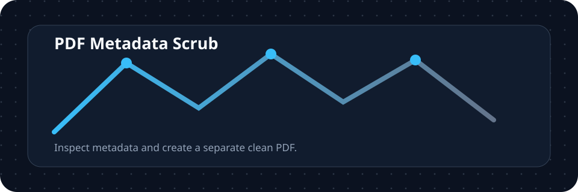

<div align="center">


[](LICENSE)



</div>

## :compass: Overview

A small Python CLI for inspecting PDF document information and creating a clean copy with document metadata removed. The source file is never modified.

## :sparkles: Features

- :white_check_mark: Lists document-info metadata keys and values
- :white_check_mark: Writes a separate output PDF with metadata cleared
- :white_check_mark: Refuses to overwrite the input file
- :white_check_mark: Processes documents locally without uploading them

## :clapper: Demo

```bash
python main.py inspect path/to/your-file.pdf
```

Replace the path with a PDF you own; this repository does not include a sample document.

## :rocket: Quick Start

```bash
python -m pip install -r requirements.txt
python main.py --help
```

Run `python main.py --help` to see all supported options.

## :toolbox: Tech Stack

- Python 3.10+ and pypdf
- Automated tests: unittest for path-safety and metadata helpers
- Local-first processing

## :file_folder: Folder Structure

```text
pdf-metadata-scrub/
├── main.py
├── requirements.txt
├── tests/test_core.py
├── examples/README.md
└── assets/illustration.svg
```

## :world_map: Roadmap

- [x] Core workflow and CLI
- [x] Example input and tests
- [ ] Additional report formats
- [ ] Continuous integration on supported platforms

## :handshake: Contributing

Issues and pull requests are welcome. Keep changes focused, document behavior changes, and add tests for new features.

## :page_facing_up: License

MIT - see [LICENSE](LICENSE).

<div align="center"></div>
